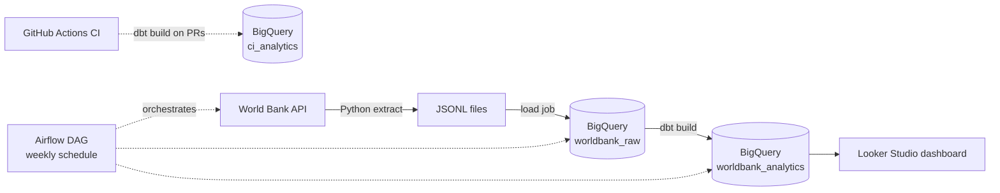

# World Bank Batch ELT Pipeline

A batch ELT pipeline that pulls World Bank development indicators, loads them into BigQuery, transforms them with dbt, and serves a Lebanon vs Gulf comparison dashboard. Airflow orchestrates everything, and GitHub Actions tests every change against a separate BigQuery dataset.

**Dashboard:** [Lebanon vs Gulf: World Bank indicators](https://datastudio.google.com/reporting/2f86681c-78bc-4148-a9af-e5ac7997814b)

## Architecture



## Stack

| Layer | Tool |
|---|---|
| Orchestration | Apache Airflow 2.9.3 (Docker Compose, LocalExecutor) |
| Extraction | Python (`requests`) |
| Warehouse | Google BigQuery |
| Transformation and tests | dbt Core 1.12.6 with `dbt-bigquery` 1.12.1 |
| CI | GitHub Actions, ruff |
| Dashboard | Looker Studio |

## Data

Five World Bank indicators for all countries, 2000 to 2025: GDP per capita (US$), population, life expectancy, inflation (%), and unemployment (%), plus a country table with region and income level.

## Pipeline

The `worldbank_pipeline` DAG runs three tasks in order:

1. **extract**: pulls every page of each indicator and the country list from the World Bank API and writes JSONL files partitioned by run date.
2. **load_to_bigquery**: loads the files into `raw_indicators` and `raw_countries` with an explicit schema. Each load replaces the table (`WRITE_TRUNCATE`), so reruns never duplicate rows.
3. **dbt_build**: runs the models and tests together. A failing test fails the DAG run.

**Operations:** weekly schedule (Mondays 06:00 UTC), 2 retries on extract/load and 1 on dbt, a 20-minute timeout per task, a single active run, and an optional Discord webhook alert on task failure.

## dbt models

| Model | Type | Purpose |
|---|---|---|
| `stg_indicators`, `stg_countries` | view | light cleanup over the raw tables; flags regional aggregates |
| `dim_countries` | table | real countries only; aggregates like "World" or "Arab World" are excluded |
| `fct_indicators` | incremental (merge) | one row per country, indicator and year, keyed by a hash of the three |
| `mart_lebanon_vs_gulf` | table | Lebanon vs the average of Saudi Arabia, UAE, Qatar, Kuwait, Bahrain and Oman, with the gap and ratio |

**Data tests (11):** uniqueness and not-null on keys, a relationship test from the fact table to the country dimension, an accepted-values test on indicator names, and not-null checks on the mart. After repeated runs, the fact table holds 26,040 rows with 26,040 distinct keys, so there are no duplicates.

## CI

Every pull request and push to `main` lints the Python with ruff and runs `dbt build` against a separate `ci_analytics` dataset, so a broken change cannot touch the production tables. I verified that it blocks bad changes by pushing a deliberately broken test: the `accepted_values` test failed, the mart and its tests were skipped, and the check went red.

## A finding

In 2024, Lebanon's GDP per capita was about $4,500, against about $40,700 for the Gulf average. Over 2000 to 2024, Lebanon's value ranged from roughly 10% to 25% of the Gulf average.

## Run it locally

Requirements: Docker Desktop and a GCP project with BigQuery enabled.

```bash
git clone https://github.com/3asseff/worldbank-elt-pipeline.git
cd worldbank-elt-pipeline

# 1. Create a service account with the BigQuery Data Editor and BigQuery Job User roles,
#    download its JSON key, and save it as secrets/gcp-key.json (git-ignored)
mkdir -p secrets

# 2. Set your project id in include/bigquery_load.py and dbt_project/profiles.yml

# 3. Optional: add ALERT_WEBHOOK_URL=<discord webhook> to .env for failure alerts
echo "AIRFLOW_UID=50000" > .env

# 4. Start Airflow
docker compose build
docker compose up airflow-init
docker compose up -d
```

Open http://localhost:8080 (login `admin` / `admin`), unpause `worldbank_pipeline`, and trigger it.

## Design decisions

- **dbt runs in its own virtualenv inside the Airflow image**, which avoids dependency conflicts between the two tools.
- **Idempotent by design.** Raw tables are replaced on every load, and the fact table merges on a hash key, so any run can be repeated safely.
- **`dbt build` instead of `run` then `test`**, so a failing test stops the downstream models and fails the DAG.
- **Regional aggregates are removed in the dimension**, using the World Bank's own region flag, so the fact table can only contain real countries.
- **CI uses its own dataset**, so a failed test cannot damage production data.

## What went wrong and how I fixed it

- **An unpinned install pulled in a beta dbt release (1.13.0-b1).** I pinned `dbt-core==1.12.6` and `dbt-bigquery==1.12.1` in the Dockerfile.
- **Port 8080 was already taken** by an older Airflow stack still running in Docker. I stopped the old containers.
- **A dbt deprecation warning** about generic test arguments appeared in CI. I moved the arguments under the `arguments:` key.
- **CI lint failures after a ruff upgrade.** Newer default rules started flagging style issues, so I pinned the rule set in `ruff.toml` to errors and unused imports.
- **Dashboard spikes.** Looker Studio treated yearly data as daily and drew zeros between points. I set the date granularity to Year.

## Limitations

- The World Bank publishes with a delay, so 2025 is mostly empty and the dashboard runs through 2024.
- Some series have gaps. Lebanon's inflation, for example, covers fewer years than its GDP, and the mart only keeps years where both Lebanon and the Gulf have values.
- The Gulf figure is a simple unweighted average of six countries.
- It runs locally on Docker with a service-account key. A production deployment would use managed Airflow and workload identity.

## Next steps

A Spark project on a larger dataset, and an ML extension of my [crypto streaming pipeline](https://github.com/3asseff/crypto-streaming-pipeline).
